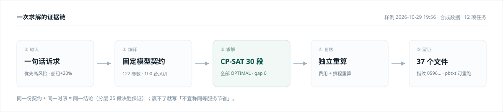
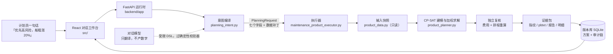

<div align="center">

# 一修 · 海上风电检修排程 Agent

**一句话说清要修什么，系统给你一份能审、能复算、能落库的检修计划。**

[](https://github.com/DrYuany/ai-maintenance-window-forecast/actions/workflows/ci.yml)


</div>

<!-- 工作台截图/GIF 补这里（放在下面这张流程图上方的位置最好）：
     拍摄与截取要求见 docs/assets/README.md
      -->



> 上图是一次真实运行的完整路径。数字全部来自 `docs/sample-run/`，可以逐个核对。

---

## 90 秒能验证的三件事

没人会为一篇 README 装 OR-Tools。所以下面每一条都给一个**不装环境也能查**的证据。

| 承诺 | 仓库里怎么验证 |
| --- | --- |
| **页面上的数字不是模型编的** | [`docs/sample-run/`](docs/sample-run/) 是一次真实求解的产物切片（5 份，93 KB）：摘要、报告、30 段求解记录、模型契约、逐任务明细。数字对得上，指纹可查 |
| **"超时"不会被说成"无解"** | 四态 `OPTIMAL / FEASIBLE / UNKNOWN / INFEASIBLE` 在 [`backend/app/core/maintenance_product_executor.py:180`](backend/app/core/maintenance_product_executor.py#L180) 强制区分；超时走启发式兜底时，报告写"尚未证明最优" |
| **赢不了就不吹赢** | 与人工基线任务集合不同时，报告写"不宣称同等服务节省"而不是硬算节省率 —— [`maintenance-milp-modeler/scripts/product_report.py:46`](maintenance-milp-modeler/scripts/product_report.py#L46) |

想直接看"一次求解到底留下了什么"，读 [`docs/一次求解留下了什么.md`](docs/一次求解留下了什么.md)。

## 这是什么问题

海上风电场一次大修要同时回答四件事：**哪些任务必须在哪个窗口做完、派哪几条船、
备件够不够、总代价多大**。计划员现在用 Excel 加经验排，改一个约束重排半天，
排完还说不清"为什么是这台风机"。

一修把它变成一句话：计划员说「优先修高风险，船租涨了 20%，每天最多两条作业线」，
系统把这句话编译成一份**形状固定的** CP-SAT 整数规划，真求解，再由独立计算器复核，
最后把方案、模型指纹、审计链一起入库。

> 一条铁律：**大模型只负责翻译，不负责算数。**
> 界面上任何一个数字，要么来自 CP-SAT，要么来自只读计算工具，要么来自用户输入。
> 这一条决定了后面所有的架构选择。

## 架构



三层职责切得很硬：

- **懂中文的那层（LLM）**：只输出结构化 DSL，产物必过确定性校验器，编造的字段直接拒；
- **会算错的那层（CP-SAT）**：只接受固定形状的模型；目标固定为一段标准化加权目标，
  配置在 `RunSpec` 一次定稿，整份时限都给这一段，模型与证据逐份留痕；
- **说人话的那层（报告）**：只搬运前两层的数字，不产生新数字。

### 这不是 ReAct

名字容易撞：**前端是 React（框架），后端 agent 不是 ReAct（Reasoning + Acting 范式）。**

- **前端**：React 18 + Vite，在 `src/`。
- **后端 agent**：原生 tool-calling loop。`conversation_agent.py:127` 那个
  `for _ in range(self.max_rounds)`（最多 4 轮），模型直接吐出结构化的
  `tool_use` 块，系统执行后把 `tool_result` 回灌。行动是**字段**，不是从自然语言的
  思考里解析出来的——这一层直接取代了 ReAct 的 `Thought / Action / Observation`
  格式约定，所以代码里搜不到任何 `Thought:` 字样。
- **刻意不要那个 Thought**：ReAct 的 Thought 是模型自述的推理文本。一旦拿它当依据，
  就和状态诚实性冲突——模型说"我查过库存"，不等于库存真够。这套里推理轨迹不落盘、
  不参与判定，判定只认确定性产物（校验结果、求解状态、重算差值）。
- **主链路就是这条工具循环**：一句话 → 模型自主选工具（读事实 / `solve` 出预览 /
  `submit_change` 提交）→ 系统执行 → 结果回灌 → 受控旋钮编译 → CP-SAT。
  求解是**单次编译**，不是模型自己迭代到满意；确认是工具调用，不是关键词短路。
  词表路由、规则兜底答案和 `AGENT_ENGINE=rule` 回滚开关都已撤销。

一句话：**外壳是 tool-calling loop，内核是受控编译。** 工具循环、会话记忆、多方案对比、
审批是壳；「用户意图 → 受控 DSL → 固定模型契约」才是内核。

顺着这条链还做了四件配套的事，都因为"不留痕就不算可审计"：

| 能力 | 存在哪 | 一句话 |
| --- | --- | --- |
| 会话记忆 | `backend/app/core/conversation_memory.py` | 结构化快照（状态/约束/产物/动作/问答）+ 滚动摘要，聊到后面还记得最初那句"船租涨 20%" |
| 规格状态 | `yxcore/session.py` | 只有真排出过方案的要求才算「已验证」；求解失败就撤回到上一份能解出的规格，不把没验过的要求带进下一轮 |
| 多方案对比 | `backend/app/core/version_compare.py` | "对比方案 01 和 02"由确定性工具算三层差异：事实与差值、差异归因、下钻索引 |
| 并发求解 | `backend/app/core/maintenance_product_executor.py:120` | 按输出目录加锁，后台在跑的旧任务不会被新任务覆盖，前端多任务跟踪 |
| 审批与库存闭环 | `maintenance-milp-modeler/scripts/product_writeback.py` | 检修单 → 出海清单 → 完工反馈 → 销账，计划预留与实物扣库分开，制单/审批分离 |

## 快速开始

需要 **Python 3.12**（OR-Tools 的 wheel 目前主要覆盖 3.12）和 **Node 20+**。

```bash
# 以下命令都在仓库根目录执行
# 1. 后端依赖
python -m pip install -r backend/requirements.txt

# 2. 对话模型（必配：没 key 时接口如实报错，不会换一套规则答案冒充）
cp backend/.env.example .env.local     # 填 MINIMAX_API_KEY（Windows: copy backend\.env.example .env.local）

# 3. 起后端（端口 8010，前端 dev server 会代理到这里）
python -m uvicorn app.main:app --app-dir backend --port 8010

# 4. 起前端（另开终端）
npm ci && npm run dev                   # http://localhost:3000
```

> 环境变量沿用历史命名 `MINIMAX_*`，实际指向 DeepSeek 的 Anthropic 兼容端点
> （`MINIMAX_BASE_URL=https://api.deepseek.com/anthropic`）。这是早期接入留下的名字，
> 换模型只改 base_url 和 model，不动代码。

不配 key 服务照样能启动，但对话接口会明确回「这一轮没能调用大模型」——状态诚实性优先于凑一个答案。

## 一次求解到底留下什么

求解不是"返回一个 JSON 就完事"。每次运行落一个目录：

```
product-output/agent-model-05964b74fe156609/
├── model_artifact.json        模型契约：变量、约束、目标、参数来源、数据快照哈希
├── solver_model.pbtxt         CP-SAT 原始模型（1.5 MB）——换求解器也能重跑
├── solver_model_stage_1.pbtxt 唯一一段标准化加权目标
├── 结果.json                  全部阶段的求解记录 + 推荐排程 + 人工基线 + 费用明细
├── 推荐摘要.md / 推荐报告.html  给人看的两版结论
├── 维修任务明细.csv            现场拿去排班
└── 输入快照.json              求解时的完整输入（输入变了立刻暴露）
```

> **当前产品固定只有一个目标函数（标准化加权），恒为 1 段**，整份时限都给它。
> 策略、权重、时限、容差、展望期、业务约束在 `RunSpec.resolve()` 一次定稿，
> `spec.facts()` 是所有产物字段的唯一映射；`结果.json` / `model_artifact.json` /
> 求解结果 / 版本摘要都不许再各取一份默认值。逐项对齐由
> [`tests/test_run_spec_consistency.py`](maintenance-milp-modeler/tests/test_run_spec_consistency.py) 守门。
>
> 分层字典序目标与「确定性决胜段」已整块删除，不再产生 `solver_model_tie_*.pbtxt`，
> 也不再承诺「同一契约同一时限必得同一张排程表」。下面这份 30 段样例是
> **历史归档产物**，留作证据链说明，不代表当前运行会生成的东西。

样例（历史归档）：12 项任务、1 个可用窗口、30 段全部 `OPTIMAL`、gap = 0。那是分层时代
按模板声明的顺序逐段求解 + 25 段决胜的产物；现在不会再出现。完整拆解见
[`docs/一次求解留下了什么.md`](docs/一次求解留下了什么.md)。

## 几个硬取舍

| 决策 | 放弃了什么 | 为什么 |
| --- | --- | --- |
| 固定模型契约，LLM 只填参数 | 让 LLM 现场写建模代码（更"通用"） | 现场生成的模型每次形状都不同，指纹失去意义，出的错也无法归因 |
| 固定单一标准化加权目标 | 分层字典序 / 让用户现场改目标形状 | 目标结构固定才有稳定指纹与可核对的产物；能改的是权重和业务约束，不是目标本身。分层与决胜段已删除 |
| 求解状态四态 + 兜底标注 | 只报"成功 / 失败" | 超时被说成"无解"会让人放弃本来有解的问题；"未证明最优"混进"最优"会让人过度信任 |
| 参数注册表携带"落点" | 设计文档、提示词、代码各维护一份可改清单 | 见下 |
| 抽出 `dsl_core/` 中立包 | 后端和 `llm-first/` 各写一份解析 | 两套理解层要对比，共用一个 DSL 内核才不会连对比基准都不一样 |

第四条踩过坑，值得单独说：

> 参数总表有 122 项。历史上"哪些参数可改"这件事被手抄在三处 ——
> 设计文档、提示词、执行侧白名单。设计文档和提示词说 51 项可改，
> 执行侧只认 16 项，于是用户改剩下 35 项必报"未支持参数"。
> 三份手抄清单之间没有任何测试比对，这个矛盾活了很久。
>
> 现在改成：**登记参数时必须同时登记"落点"**（从 DSL 到模型的实际通路）。
> 没有落点的参数 `is_changeable()` 为假，提示词不会把它列进"你能改什么"。
> 单一事实源不是靠纪律，是靠"不登记就跑不通"。
> 出处：[`dsl_core/registry/parameters.py`](dsl_core/registry/parameters.py#L1-L15)

## 评测

不是测"看起来对不对"，是测**能不能复算**：

```bash
cd backend
python -m pytest -q            # 默认套件（排除 slow）：580 条
python -m pytest -m slow -q    # 40 条真求解端到端（单次 1–4 分钟，整轮半小时以上）
```

| 层 | 规模 | 测什么 |
| --- | --- | --- |
| 后端 | 580 条（`-m "not slow"` 实收） | 意图解析、DSL 校验、状态诚实性、并发不覆盖、审批与库存闭环 |
| 慢速 | 40 条（`-m slow`） | 真的建模型、真的调 CP-SAT、断言产物齐全与指纹可复现 |
| 前端 | 29 条 / 9 个文件（`vitest run --exclude '**/.worktrees/**'`） | 对话流、证据面板、方案卡渲染 |

数字是 2026-11-02 用 `--collect-only` 与 `vitest run` 实测的；CI 每次 push 会把实际收集数打进日志，以那个为准。

> 注意前端那条：直接跑 `vitest run` 会报 18 个文件 / 58 条，是把仓库里
> `.worktrees/agent-tool-loop-v2/` 那份副本也扫了一遍（`vitest.config.ts` 没排除它）。
> 主仓库真实规模是 9 个文件 / 29 条。

三条发布闸门，任一不过不发版：**状态诚实性**（超时/无解不许混）、
**模型指纹重复性**（同契约同结果）、**证据链完整性**（报告里每个数字能追到产物）。
全部在本地判分，不依赖在线 LLM 打分 —— 让 LLM 给 LLM 打分，等于没有闸门。

CI 见 [`.github/workflows/ci.yml`](.github/workflows/ci.yml)。

## 已知限制

写清楚这些，比多写三个功能有用：

- **数据全是合成的。** 部件工时、降额系数、船租、备件价格都是假设值，
  没有接现场的告警、SCADA、海事许可、ERP 库存。换真实数据不是改个路径的事。
- **单机形态。** SQLite + 本地令牌认证，适合验收和单机试点；多租户、权限体系、
  监控告警、备份恢复都没做。
- **完工反馈是整单级的。** 逐任务的实际工时与偏差回写还没做，闭环只闭到"整张检修单"。
- **演示告警台账只增不减。** 首批 11 条、之后每 4 天新增一条，铺到 11-27 共 20 条，
  所有记录都是「待安排」，没有一条被结案。所以水位线随日期只涨不落，
  **结案回写让切片缩小这件事，本演示没有验证过**，别把它当成已跑通的闭环。
  演示站把规划时点钉在 11-08 保证可复现，生产部署不设该变量就跟随当天。
- **规格锚点只在进程内存里。** 每份「已验证规格」连同它当时的规划时点、告警水位线
  都跟着会话对象活，服务重启或换实例就没了，也没有写进持久化会话记忆。
  台账往前走时系统会提示这版规格是按旧时点算的，但**不会自动重排**——
  重排会改方案，得由用户发起。
  规格状态现在能无损导出/导入（`Session.export_spec()` / `import_spec()`），但
  **没有接进 SQLite**：接上会把「服务重启 = 新会话」改成「接着上一版继续」，
  属于产品语义变更，需单独拍板。评估、改动面与验收标准见
  [`docs/规格锚点持久化评估.md`](docs/规格锚点持久化评估.md)。
- **对模型能力有依赖。** 自由表述的理解依赖对话模型；没配 key 或调用失败时，
  接口如实说没答上来，不会伪造一份规则生成的答案。

所以现在不能宣称"除数据外已与生产系统一样"。完整边界见
[`PRODUCT_READINESS.md`](PRODUCT_READINESS.md)。

## 目录

```
backend/                  FastAPI 运行时：意图编译、工具循环、会话记忆、审计落库
src/                      React 对话工作台（对话 / 甘特 / 证据面板）
maintenance-milp-modeler/ 求解内核：数据冻结、RunSpec 定稿、加权建模求解、独立复核、报告与台账
dsl_core/                 中立 DSL 包：注册表、校验器、编译器（后端与 llm-first 共用）
llm-first/                并行的 LLM 主导版（与规则主导版并排对照的实验，未进产线）
data/                     合成数据：100 台风机、8 类部件、122 项参数、35 天海况
docs/                     设计文档、决策记录、评测矩阵、演示手册
docs/prototype/           最早的单文件原型（2.6 MB，双击即看，不需要后端）
scripts/                  演示托管、自检、单文件打包
```

## 文档

先读这两份，其余按需：

- [一次求解留下了什么](docs/一次求解留下了什么.md) —— 证据包逐文件拆解，配真实数字
- [项目全景与学习路线](docs/2026-10-28-项目全景与学习路线.md) —— 每个文件管什么、从哪看起

再往下：

- [Agent 场景与验收矩阵](docs/2026-10-27-agent-scenario-requirement-matrix.md) —— 每个场景的验收口径
- [工具循环与对比契约](docs/2026-10-27-tool-agent-and-compare-contract.md) —— 工具边界与多方案对比
- [受控 DSL 设计](docs/2026-10-29-milp-controlled-dsl-design.md) —— 为什么不让 LLM 直接建模
- [演示部署手册](docs/2026-10-30-演示部署手册.md) —— 一条命令起带口令的演示站

## 给人演示

`npm run build` 出单文件前端，`python scripts/demo_serve.py` 起服务并生成访问口令，
隧道挂上就是邀请链接（需自备 cpolar 账号）。口令机制、版本标记、常见问题见
[演示部署手册](docs/2026-10-30-演示部署手册.md)。

体验是两段式：**前 10 轮用服务端密钥，之后要求访客填自己的 DeepSeek 密钥**
（`DEMO_FREE_TURNS` 改轮数，`DEMO_DAILY_TURNS` 封每日总消耗）。访客密钥只存在
浏览器里，随请求带过来、用完即弃，不落库不写日志。

线上演示站由 `scripts/build_deploy.py` 把规划时点钉在 **2026-11-08 18:00**：
15 条告警、按代价权衡排出 13 条并明说少修 2 个，每次打开都是同一份可复现的方案。
本地开发与生产部署不带这个变量，时点跟随当天，告警自然累积；
现场数据概览会写明时点来源和告警水位线，不会把钉住的日期冒充实时数据。

## License

MIT，见 [LICENSE](LICENSE)。
